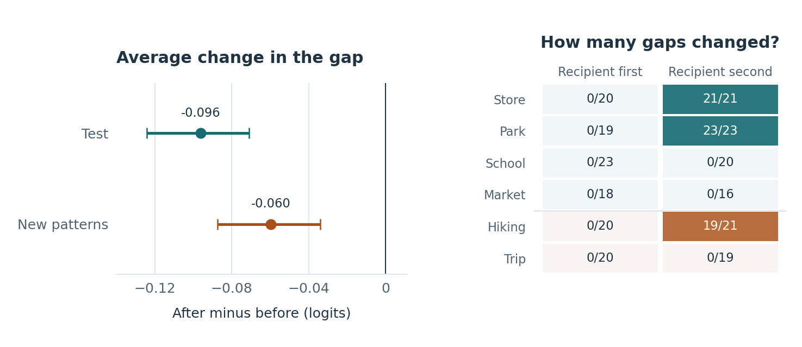

# IOI Sparse Autoencoder

Can one feature inside GPT-2 tell us whether the recipient in a sentence was named first or second? This project studies **indirect object identification (IOI)**. The input is a short sentence with two names. The task is to predict who receives something.

> When Paul and George went to the store, Paul gave a bottle to

The expected next name is **George**. GPT-2 gives each possible next token a score called a **logit**. Here, the **score gap** is George's logit minus Paul's logit. In this example, the gap was **4.05**. After removing one feature, it fell to **3.84**. George still had the higher score.

## What did the feature learn?

A **sparse autoencoder (SAE)** is a small model that learns to rebuild values from inside GPT-2. It uses only a few features for each sentence. In this run, feature **260** was more active when the person receiving the object was the second name.

| Result | Familiar sentence patterns | New sentence patterns |
| --- | ---: | ---: |
| Test prompts | 160 | 80 |
| How well the feature predicted name order (AUROC) | 0.7750 | 0.7375 |
| How well the SAE rebuilt the values (explained variance) | 85.41% | −30.64% |
| Average change in the score gap after removing the feature | −0.09615 | −0.05970 |
| Prompts where the gap fell | 44 of 160 | 19 of 80 |
| Prompts where the other name took the lead | 0 of 160 | 0 of 80 |

An AUROC of 0.5 is chance. A score of 1 means the feature separates the two name orders perfectly. The negative explained variance means that, on the new patterns, using the average value for each input dimension gave a smaller error than the SAE.

All 19 changes on new patterns came from the hiking sentences. The exact wording mattered. The results come from one training run. [Read the report](reports/research_report.md) · [PDF version](reports/research_report.pdf)



## Phase 2: Counterfactual role swaps and steering

The follow-up experiment used the same SAE and selected feature 260 on **48 role-swapped prompt pairs** (96 prompts). Feature 260 separated the two name orders with AUROC **0.8125** and changed in the expected direction for **30/48 pairs**. Removing its decoded contribution changed the correct-name logit gap by **-0.10538** on average; adding one extra contribution changed it by **+0.09731**. No prompt switched its preferred name. The effect only appeared on two of the four sentence templates.

The selected direction showed a larger RMS effect than the eight tested matched-magnitude control directions. This is evidence of a **template-dependent causal effect on the logit gap**, not evidence of a general-purpose indirect-object concept.

[Phase 2 code and instructions](phase2/README.md) · [Verified research report](phase2/PHASE2_REPORT.md) · [Steering figure](phase2/figures/steering.svg) · [Template figure](phase2/figures/by_template.svg) · [Saved evidence](phase2/evidence/)

The saved results were checked against all 3,456 CSV rows, but GPT-2 was not independently rerun during this verification. Further work includes new sentence templates and multiple SAE training seeds.

## Check the results

Run these commands in the main project folder. The check uses the saved model weights, GPT-2 values, and scores for each prompt. It runs on a CPU and works offline after you install the packages.

```bash
python -m pip install "numpy>=1.24,<3" "scikit-learn>=1.3,<2" "matplotlib>=3.7,<4"
python -m analysis.verify
```

To make the figures again, run `python -m analysis.verify --figures runs/rebuilt-figures`. To see the steps and inspect one prompt at a time, open the [results notebook](notebooks/inspect_results.ipynb).

## Run the experiment yourself

Use Python 3.10 or newer. The first run downloads GPT-2 Small. A GPU will speed up training and evaluation.

```bash
python -m pip install -r requirements.txt
python -m pytest -q
python run_pipeline.py --stage all --seed 42 --out runs/seed42
```

The four stages are `data`, `baseline`, `train`, and `evaluate`. You can run them one at a time in that order. Use the same output folder for all four. For a short practice run, use `python run_pipeline.py --stage all --quick --out runs/smoke`. The [experiment notebook](notebooks/run_experiment.ipynb) also works in Google Colab.

## Project files

- [run_pipeline.py](run_pipeline.py) and [src/](src/) contain the code to make prompts, train the SAE, and test features.
- [results/seed42/](results/seed42/) contains the data and weights from the saved run. [verified_metrics.json](results/verified_metrics.json) contains the numbers we checked.
- [analysis/](analysis/) contains the code that checks the results and draws the [figures](figures/).
- [notebooks/](notebooks/) contains the two notebooks. [reports/](reports/) contains the report. [tests/](tests/) contains the code tests.

The original run saved a score change for each prompt for feature 260. For the eight comparison features, it saved only summary numbers. We could check which comparison features were chosen. Their effects are an open question.
