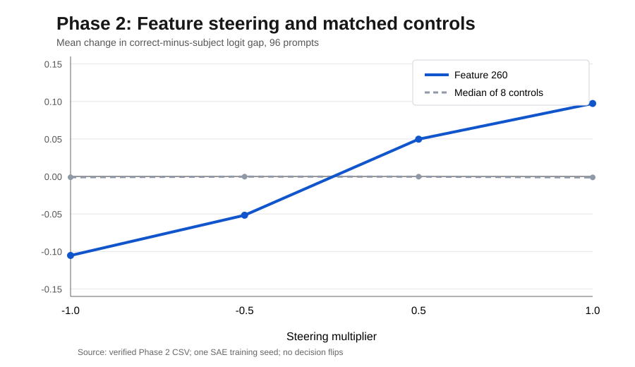
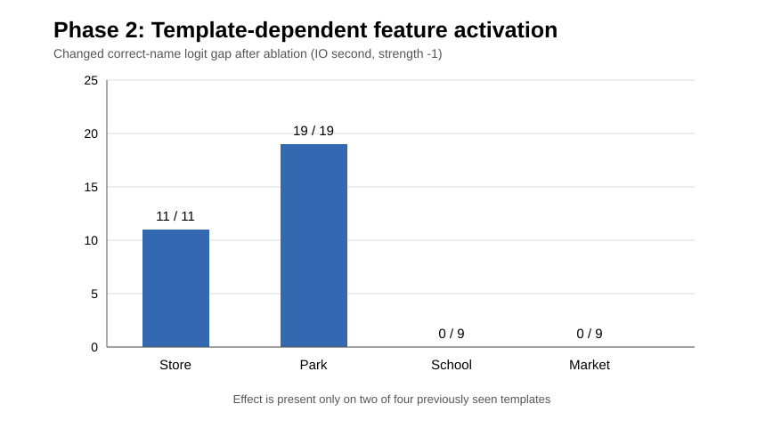

# Phase 2: Counterfactual Role Swaps and Feature Steering

**Status: the 48-pair run is complete. Results were checked for internal consistency against 3,456 saved rows. GPT-2 was not independently rerun for this verification.**

This phase continues the [Phase 1 IOI SAE study](../README.md). It reuses the trained layer-8 Top-K SAE and feature 260, which was selected on Phase 1 development prompts.

## Research questions

1. When we change which name is repeated as the subject, does feature 260 change with the indirect object's role?
2. Does subtracting or adding its decoded contribution systematically change the correct-minus-subject logit gap?
3. Is this effect stronger than the effects of eight SAE decoder directions with the same per-prompt edit magnitude?

## Key findings

| Metric | Observed value |
| --- | ---: |
| Counterfactual pairs | 48 |
| Prompts | 96 |
| Feature 260 order AUROC | 0.8125 |
| Pairs with response in expected direction | 30 / 48 |
| Feature-active prompts | 30 / 96 |
| Mean logit-gap change at strength -1.0 | -0.10538 |
| Mean logit-gap change at strength +1.0 | +0.09731 |
| Pairwise predictions flipped | 0 |

The selected direction had an RMS gap change of 0.20531 at strength -1.0, compared with 0.02419–0.13424 for the eight control directions. All observed effects were limited to two of four sentence templates, so the evidence does not show a general indirect-object feature.





[Read the complete English Phase 2 report](PHASE2_REPORT.md).

## Data and reproducibility

The [evidence folder](evidence/) contains the original row-level evidence, split into nine CSV files (one for the selected direction and one for each control), plus a JSON summary of the stored run. No rows have been dropped. The summary was reconstructed from the row-level CSV together with the original saved counterfactual metadata. It is not byte-identical to the initially uploaded JSON.

Run the offline check:

```bash
python -m phase2.verify_results
```

The script reconstructs the original CSV byte stream, checks its original SHA-256, validates 3,456 rows, and recomputes the intervention metrics. It **does not** rerun GPT-2.

## Reproduce the GPU experiment in Colab

Install the requirements from the repository root and run:

```bash
python -m pip install -r requirements.txt
python -m pytest -q
python -m phase2.run_phase2 --pairs 48 --out runs/phase2
```

The script downloads GPT-2 Small and uses the Phase 1 weights saved under `results/seed42/`. For a quick test, change `--pairs 48` to `--pairs 8`.

## Limits

The role swap changes multiple input tokens, not just a single hidden semantic variable. Feature 260 did not flip any pairwise decision; it only changed the size of the logit gap. Only one SAE seed, one layer, eight control directions, and four already-seen templates were tested. Generalization to new sentence templates remains unresolved; Phase 1 had poor OOD reconstruction. See the full report for details.

The experiments are complete for this two-phase project, but these limitations remain appropriate topics for future work.
