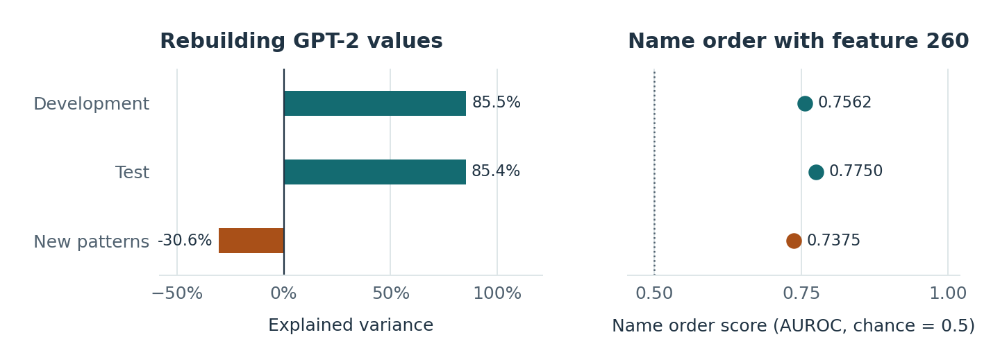
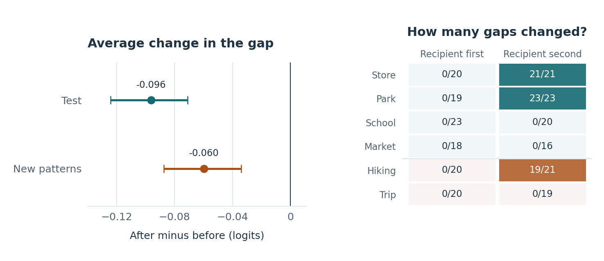

# Name order in GPT-2

A sparse autoencoder experiment with two names

## The question

Consider the sentence “When Paul and George went to the store, Paul gave a bottle to”. Who gets the bottle? George does. Paul is the subject, and George is the recipient, also called the indirect object. In this example the recipient is the second name. We asked whether one feature inside GPT-2 could track this order, and whether removing it would change the scores for the two names.

## How we ran the experiment

We used four sentence patterns to make 2,048 training prompts, 160 development prompts, and 160 test prompts. Each group used different names. We also made 80 prompts with the test names and two new patterns. We call this the out-of-distribution (OOD) set. In every set, the recipient came first in half the prompts and second in the other half.

We kept GPT-2 Small's weights fixed. For each prompt, we saved its 768 internal values at the last token (“to”), just after block 8 (counting from zero). A sparse autoencoder (SAE) learned to rebuild those values. It had 1,536 possible features and could use up to 32 per prompt. We used the training data to center and scale the inputs. We trained for 800 steps with Adam, a batch size of 256, a learning rate of 0.0003, and seed 42. We kept the saved model with the lowest error on the development prompts.

## Which feature tracked name order?

We compared how strongly each feature responded when the recipient came first and when the recipient came second. We used the development prompts to choose a feature. To compare features on the same scale, we divided each difference in average response by the feature's standard deviation. We considered features that were active on 3% to 97% of these prompts. Feature 260 had the largest absolute difference. It responded more strongly when the recipient came second.

AUROC measures how well a score separates the two name orders. Here, 0.5 means chance and 1 means perfect separation. Using feature 260 gave 0.7750 on the test set and 0.7375 on the new patterns. A simple classifier (logistic regression) that used all 768 values reached 1.0000 on both sets.

The SAE explained 85.41% of the variation in the test values. On the new patterns, this fell to −30.64%. A negative value means that guessing the average for each dimension in that set gave a smaller error than the SAE.

## What changed when we removed feature 260?

GPT-2 gives each possible next token a score called a logit. We measured the score gap by subtracting the subject's logit from the recipient's logit. In the bottle example, a positive gap means that George scores higher than Paul.

To remove feature 260, we subtracted the part it added to GPT-2's values at the last prompt token. We used the feature's strength, its decoder direction, and the scale from training. We then let the rest of GPT-2 run and measured the gap again. In the bottle example, George's lead fell from 4.05041 to 3.84100 logits.

| Result | Test | New patterns |
| --- | ---: | ---: |
| Average gap before removal | 3.27375 | 2.76900 |
| Average gap after removal | 3.17760 | 2.70930 |
| Average change in the gap | −0.09615 | −0.05970 |
| 95% interval for the average change | [−0.12419, −0.07108] | [−0.08731, −0.03389] |
| Prompts where the other name took the lead | 0 of 160 | 0 of 80 |

Every change made the recipient's lead smaller. All 44 test changes came from sentences about the store or the park. On the new patterns, the gap fell for 19 of 21 hiking prompts with the recipient second. It stayed the same for all 19 trip prompts with the recipient second. The correct name still scored higher on all 240 prompts.

## What can we learn from this run?

Feature 260 helped the correct name in some sentence patterns. Its response depended on both name order and wording. To test this further, we could keep the words fixed and swap the two names. The 95% intervals above come from resampling the prompts 1,000 times. They describe this one model and training run.

We checked the numbers using the saved weights, GPT-2 values, and score changes for each prompt. The original score files use five decimal places. The run saved only summary numbers for the eight comparison features, so we leave their effects out of the results. We did not train a second model or run GPT-2 again for this check. The original files record the model name and package versions. The exact GPT-2 version used for the download is unknown.

## Sources

- Project files. [Saved data](../results/seed42/) · [Results](../results/verified_metrics.json) · [Code to check the results](../analysis/verify.py)
- Kevin Wang et al. (2022). Interpretability in the Wild: a Circuit for Indirect Object Identification in GPT-2 small. [arXiv 2211.00593](https://arxiv.org/abs/2211.00593)
- Aleksandar Makelov, George Lange, and Neel Nanda (2024). Towards Principled Evaluations of Sparse Autoencoders for Interpretability and Control. [arXiv 2405.08366](https://arxiv.org/abs/2405.08366)
- Language model. [GPT-2 Small](https://huggingface.co/openai-community/gpt2)
